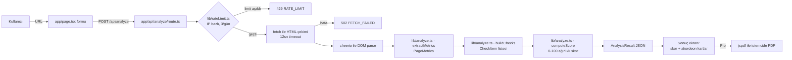
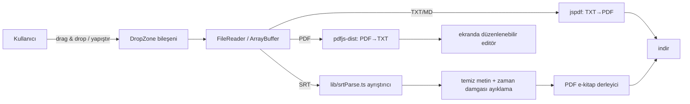
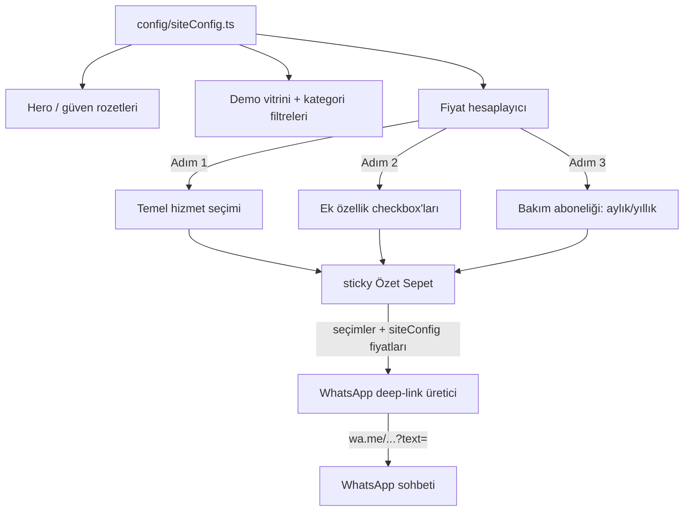
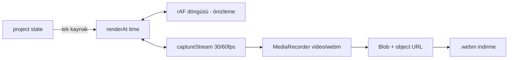

# Mimari Dokümanı

Bu doküman, `saas` paketi içindeki dört bağımsız uygulamanın (SeoRadar, KonvertLab,
Terneon, Parselya) mimari kararlarını, veri akışlarını ve teknik kısıtlarını açıklar.

Not: `rea/` dizini bu paketle ilgisizdir, mimariye dahil değildir.

---

## 1. Genel Mimari

### 1.1 Neden dört bağımsız uygulama?

Paketteki her ürün **tamamen bağımsız bir Next.js 15 (App Router) uygulamasıdır**:
kendi `package.json`'u, kendi `node_modules` ağacı, kendi markası ve kendi
dağıtım hattı vardır. Bu kararın gerekçeleri:

- **Bağımsız dağıtım:** Her uygulama tek başına `npm install && npm run build`
  ile derlenip ayrı bir alan adına yayınlanabilir. Bir üründe yapılan bir
  deploy diğer üçünü etkilemez; geri alma (rollback) kapsamı tek ürünle sınırlı kalır.
- **Bağımsız marka:** SeoRadar'ın kurumsal mavisi ile Terneon'un neon karanlık
  teması aynı tasarım sistemini paylaşmaz. Ortak bir tema katmanı zorlamak
  yerine her markanın kendi Tailwind konfigürasyonu vardır.
- **Bağımsız bağımlılık ağacı:** Parselya'nın canvas/export bağımlılıkları ile
  SeoRadar'ın `cheerio` sunucu bağımlılıkları birbirini etkilemez. Bir paketteki
  güvenlik açığı veya major sürüm yükseltmesi diğer ürünlere sıçramaz.
- **Satın alınabilirlik / devredilebilirlik:** Her proje kendi diziniyle
  koparılıp tek başına teslim edilebilir.

### 1.2 Neden npm workspaces yok?

Monorepo workspace'ler (npm workspaces, pnpm, Turborepo) ortak kod paylaşımını
kolaylaştırır; ancak bu pakette **ortak çalışma zamanı kodu paylaşımı
hedeflenmemiştir**. Workspace kullanılsaydı:

- Tek bir kök `package-lock.json` tüm ürünleri birbirine kilitleyecek,
  "tek ürünü koparıp sat" senaryosu zayıflayacaktı.
- Bir üründe yapılacak bağımlılık yükseltmesi tüm workspace'i etkileyecekti.
- Build cache paylaşımı gibi monorepo kazanımları, bu ölçekteki 4 küçük
  uygulama için gerekli maliyeti hak etmiyor.

Sonuç: her proje kendi `npm install`'uyla yaşar. Ortaklık, kopyalanabilir
*desenler* düzeyindedir (dizin yapısı, tasarım sözlüğü), kod düzeyinde değil.

### 1.3 Ortak teknoloji zeminı

| Katman | Seçim | Gerekçe |
|---|---|---|
| Framework | Next.js 15 (App Router) | RSC, API route'ları, dosya bazlı yönlendirme |
| Dil | TypeScript (strict) | Ürünler arası tutarlılık, erken hata yakalama |
| Stil | Tailwind CSS v3 | Hızlı iterasyon, markaya özel konfigürasyon |
| İkon | lucide-react | Tree-shake edilebilir, tutarlı çizgi kalınlığı |
| Node | 20+ (24 ile test edildi) | Next.js 15 gereksinimi |

### 1.4 Tipik dizin ağacı

Dört uygulama da aynı iskeleti izler:

```
<proje>/
├── app/            # App Router sayfaları, layout, API route'ları
│   ├── layout.tsx
│   ├── page.tsx
│   └── api/...     # (yalnızca SeoRadar'da gerçek endpoint)
├── components/     # UI bileşenleri (hiyarşik: ui/ → feature/)
├── lib/            # Saf iş mantığı, yardımcılar (test edilebilir)
├── config/         # Marka/site konfigürasyonu (Terneon'da merkezî)
└── types/          # Paylaşılan TypeScript tipleri
```

---

## 2. SeoRadar

### 2.1 Sorumluluk

URL girilen bir sitenin HTML kaynağını sunucu tarafında çekip On-Page ve teknik
SEO metriklerini hesaplar, ağırlıklı 0–100 arası bir skor üretir ve sonuçları
renk kodlu kartlarla gösterir. Pro planda jsPDF ile PDF rapor indirilir.

### 2.2 Veri akışı



Boru hattı sırası: **fetch → cheerio → extractMetrics → buildChecks → computeScore**
(üçü de `lib/analyze.ts` içindeki saf fonksiyonlardır).
Bu ayrım her adımı saf ve bağımsız test edilebilir kılar: `extractMetrics` yalnız
ham HTML'den sayısal metrikler (`PageMetrics`) çıkarır; `buildChecks` bu
metrikleri eşiklerle karşılaştırıp `CheckItem` (durum + öneri) üretir;
`computeScore` ağırlıklı ortalamayı hesaplar.

### 2.3 Rate limit

- `lib/rateLimit.ts` in-memory bir `Map<ip, { date, count }>` tutar.
- Ücretsiz planda IP başına **günde 3 analiz**; sayaç günlük (UTC) sıfırlanır.
- İstemci tarafında `localStorage` ile ikinci bir soft-limit katmanı vardır
  (sayfa yenilense de UI kalan hakkı gösterir).
- **Üretim uyarısı:** in-memory sayaç serverless ortamda örnek başına ayrıdır ve
  restart'ta sıfırlanır. Prod için Redis (veya Upstash) tabanlı sayaç önerilir —
  bkz. `docs/ROADMAP.md` v0.2.

### 2.4 PDF üretimi ve Türkçe karakter kısıtı

- PDF, `jspdf` ile **istemcide** üretilir (Pro özelliği; sunucu CPU maliyeti sıfır).
- **Kısıt:** jsPDF'in yerleşik Helvetica fontu WinAnsi kodlaması kullanır;
  `ğüşıöçİĞÜŞÖÇ` karakterleri bu kodlamada yoktur ve bozuk glif olarak basılır.
- **Geçici çözüm:** rapor metni üretilirken Türkçe karakterler ASCII
  transliterasyona çevrilir (ğ→g, ş→s, İ→I ...). Rapor okunur ama Türkçeden uzaklaşır.
- **Gerçek çözüm:** UTF-8 destekli bir TTF fontu (örn. Inter) `jsPDF``.addFileToVFS`
  ile sanal dosya sistemine gömülüp `addFont` ile kaydedilmelidir. Font dosyası
  (~300 KB subset) istemciye bir kez yüklenir ve tüm Türkçe glifler birebir basılır.
  Bu iş madde olarak ROADMAP v0.2'dedir.

### 2.5 State yönetimi

Sunucu yanıtı (`AnalysisResult`) tek bir `useState` + küçük bir reducer ile
tutulur; global state kütüphanesi yoktur. Kalan analiz hakkı `localStorage`
özellikleriyle senkronize edilir. Yeterli ve kasıtlı olarak minimal.

### 2.6 Dış bağımlılıklar

| Paket | Neden |
|---|---|
| `cheerio` | Sunucu tarafında jQuery benzeri DOM traverse; headless tarayıcı (Puppeteer) maliyeti olmadan HTML analizi. CORS/robots nedeniyle analiz istemciden yapılamaz, sunucuda yapılmalı. |
| `jspdf` | Bağımlılığı az, senkron çalışan, istemci-side PDF üretimi. |

---

## 3. KonvertLab

### 3.1 Sorumluluk

TXT↔PDF çift yönlü dönüştürücü ve YouTube içerik üreticileri için SRT/temiz
metin → PDF e-kitap araçları. AdSense + Pro (toplu dönüşüm) gelir modeli.

### 3.2 Neden %100 istemci tarafı?

- **Maliyet:** Dosya işleme tamamen tarayıcıda olduğu için sunucu CPU/bant genişliği
  maliyeti **sıfırdır**. Ücretsiz kullanıcı trafiği büyüdükçe bu, ölçeklenebilirlik
  açısından belirleyicidir (freemium + AdSense modeli yüksek trafiğe dayanır).
- **Gizlilik:** Kullanıcıların belgeleri hiçbir sunucuya yüklenmez; bu hem
  pazarlama mesajı hem de KVKK açısından risk azaltmadır.

### 3.3 Veri akışı



### 3.4 `pdfjs-dist` worker ayrımı

`pdfjs-dist` ağır ayrıştırma işini kendi Web Worker'ında çalıştırır; ana
thread'de yalnızca API çağrıları kalır:

- Worker dosyası, `new URL('pdfjs-dist/build/pdf.worker.min.mjs', import.meta.url)`
  kalıbıyla webpack 5 tarafından asset olarak paketlenir (`lib/pdfExtract.ts`).
- `pdfjs` modülü yalnızca tarayıcıda dinamik `import()` ile yüklenir; sunucu
  tarafı bundle'ına girmez.
- Sayfa sayfa ilerleme, `pdfjs`'in kendi `onProgress` sinyalleriyle ana
  bileşene aktarılır ve progress bar'ı besler.

### 3.5 SRT ayrıştırma zorlukları

SRT formatı göründüğünden sapmalıdır; `lib/srtParse.ts` şu durumları ele alır:

- **BOM ve satır sonu çeşitliliği:** `\r\n`, `\n`, UTF-8 BOM karışımı.
- **Zaman damgası biçimleri:** `00:00:01,500` (virgüllü) ve bazı dışa aktarıcılarda
  noktalı varyant.
- **Ardışık blok numaralandırma hataları:** sıra numaraları eksik/yinelen olabilir;
  ayrıştırıcı bunlara güvenmez, blok sınırlarını boş satırdan belirler.
- **HTML etiketleri ve çift satır altyazılar:** `<i>`, `<font>` etiketleri
  soyulanır; "temiz metin" modunda cümle birleştirme yapılır.
- **Yinelenen satırlar:** bazı otomatik altyazılar satırı iki kez basar; dedupe
  katmanı içerir.

### 3.6 Dış bağımlılıklar

| Paket | Neden |
|---|---|
| `jspdf` | TXT→PDF; Türkçe karakterler için gömülü font (bkz. SeoRadar bölümü, aynı kısıt burada da geçerli). |
| `pdfjs-dist` | PDF→TXT için Mozilla'nın olgun, standalone ayıklayıcısı. |

---

## 4. Terneon

### 4.1 Sorumluluk

Web ajansı tanıtım ve satış sitesi: sektörel canlı demo vitrini, 3 adımlı
interaktif fiyat hesaplayıcı ve WhatsApp üzerinden teklif akışı.

### 4.2 `config/siteConfig.ts` yapılandırma disiplini

Terneon'da **hiçbir marka verisi bileşenlere gömülmez.** Marka adı, iletişim
bilgileri, WhatsApp numarası, demo projeleri, sektör kategorileri ve tüm
fiyatlandırma verisi tek bir `config/siteConfig.ts` dosyasında tipli nesneler
halinde durur. Bileşenler yalnızca bu nesneleri okur.

Bu disiplinin kazanımları:

- İçerik güncellemesi kod değişikliği değildir; tek dosyada kalır, tip
  denetimi yanlış alan kullanımını engeller.
- Site başka bir ajansa beyaz etiket olarak satılacaksa yalnızca bu dosya değişir.
- Fiyat tutarlılığı (kartlarda, hesaplayıcıda, WhatsApp mesajında aynı kaynak)
  otomatik sağlanır.

### 4.3 Veri akışı



### 4.4 Fiyat hesaplayıcı state'i

Hesaplayıcı state'i tek bir `useState` nesnesi + türetilmiş toplamdır:

```ts
// components/PriceCalculator.tsx — üç ayrı useState
const [selectedServiceId, setSelectedServiceId] = useState<string>(…);
const [selectedAddonIds, setSelectedAddonIds] = useState<string[]>(…);
const [subscriptionChoice, setSubscriptionChoice] =
  useState<SubscriptionChoice>("monthly");   // "monthly" | "yearly"
```

- Toplam tutar **türetilmiş değerdir** (`useMemo`), state'e yazılmaz; tutarsızlık
  ihtimali bu şekilde elenir.
- Sticky özet sepet bu state'i okur; her değişiklikte anlık yeniden hesaplar.
- Framer Motion `AnimatePresence` ile adım geçişleri ve sepetteki kalemlerin
  giriş/çıkış animasyonları yapılır.

### 4.5 WhatsApp deep-link üretimi

`lib/whatsapp.ts` seçimleri insan-okur bir Türkçe mesaj metnine derler:

1. Temel hizmet adı + fiyatı, her ek özellik adı + fiyatı, bakım aboneliği
   türü satır satır listelenir; en sonda hesaplanan toplam yer alır.
2. Metin `encodeURIComponent` ile kodlanır.
3. `https://wa.me/<numara>?text=<kodlanmış metin>` linki `rel="noopener noreferrer"`
   ve `target="_blank"` ile açılır.

Avantajı: CRM/backend gerektirmez, satış görüşmesi kullanıcının bildiği bir
kanalda (WhatsApp) başlar; mesaj metni satıcıya hazır bir teklif özeti sunar.

### 4.6 Dış bağımlılıklar

| Paket | Neden |
|---|---|
| `framer-motion` | Bildirimsel giriş/scroll/geçiş animasyonları; React ile entegrasyonu en temiz seçenek. |

---

## 5. Parselya

### 5.1 Sorumluluk

Ada/parsel bilgisinden uydu haritası üzerinde parsel sınırı çizen, kamera
animasyonu ve bilgi etiketleri ekleyen, tarayıcıda Reels/TikTok (9:16) veya
YouTube (16:9) videosu üreten editör.

### 5.2 Deterministik canvas render motoru: `renderAt(time)`

Mimarinin kalbi şudur: **tüm sahne, zamana bağlı saf bir fonksiyonla çizilir.**

```ts
renderAt(time: number): void;
```

`renderAt`, `ParcelCanvas` bileşeninin expose ettiği bir metottur; parsel
GeoJSON, stil, etiketler ve kamera hareketi gibi tüm girdiyi editör state'inden
(`state/EditorContext.tsx`) okur ve **yan etki üretmez**.
- Önizleme: `requestAnimationFrame` döngüsü `performance.now()`'dan `time`
  türetip `renderAt`'ı çağırır.
- Export: `MediaRecorder` kaydı sırasında aynı döngü gerçek zamanlı olarak
  çalışır ve **aynı `renderAt`'ı** besler.

Önizleme ile export'un birebir aynı çıkmasının nedeni budur: iki mod arasında
render kodu, hatta render sırası bile fark etmez; tek fark kare kaynağıdır
(rAF vs. captureStream). Herhangi bir "export'ta farklı göründü" sınıfı hata bu
tasarımla yapısal olarak imkânsızlaşır. Determinizmi koruyan kurallar: rastgele
sayı kullanılmaz (gerekiyorsa seed'li PRNG), zaman haricinde gizli state okunmaz,
`Math.random`/`Date.now` render yolunda yasaktır.

### 5.3 Kamera matematiği (`lib/camera.ts`)

Kamera, dünya koordinatlarından ekran koordinatlarına bir affine dönüşüm olarak
modellenir:

```ts
type Camera = { cx: number; cy: number; zoom: number; rotation: number };
// screen = rotate(zoom * (world - center))
```

- **Zoom-in (uzaydan yakınlaşma):** `zoom(t)` parametrik eğrisi geniş bir
  başlangıç ölçeğinden parsel ölçeğine `easeInOutCubic` ile iner; `cx, cy` parsel
  merkezine doğru interpole edilir.
- **Orbit (360° dönüş):** `zoom` sabit tutulurken `rotation(t)` tam tur atar;
  dönüş parsel merkez etrafındadır.
- Kamera eğrileri timeline üzerinde anahtar karelere (keyframe) bağlıdır;
  ara değerler interpolasyonla hesaplanır.

### 5.4 GeoJSON poligon projeksiyonu

1. Parsel GeoJSON (WGS84 boylam/enlem) noktaları `lib/geo.ts` ile ekran
   uzayına izdüşürülür; yerel bir offset ile parsel merkez orijine taşınır.
2. Çevre dokusu **prosedürel olarak** üretilir (gürültü + parseller + yollar);
   harici uydu karo (tile) servisi veya ağ isteği **kullanılmaz**.
3. Poligon `renderAt` içinde kamera dönüşümünden geçirilip canvas'a çizilir:
   neon kenar çizgisi, dolgu opaklığı ve kenar etrafında yumuşak bir parıltı
   (glow) katmanı.

### 5.5 Export zinciri



- `canvas.captureStream(fps)` kareleri yakalar; `requestAnimationFrame` döngüsü
  kayıt boyunca arka planda çalışmaya devam eder.
- `MediaRecorder` `video/webm;codecs=vp9` (düşüşte vp8) ile kaydeder.
- **Tarayıcı destek matrisi:**

| Yetenek | Chrome/Edge | Firefox | Safari |
|---|---|---|---|
| `captureStream` + WebM kaydı | Tam | Tam | Kısmi |
| VP9 codec | Tam | Kısmi | Yok |
| MP4 (`video/mp4`) kaydı | Son sürümlerde deneysel | Kısmı | H.264 ile çoğunlukla var |

UI bu yüzden WebM'i birincil format olarak sunar, MP4 seçeneğini tarayıcı
destek sorgusu (`MediaRecorder.isTypeSupported`) sonucuna göre
etkinleştirir/etiketler. Safari'de MP4 üretimi v0.2'de wasm tabanlı transkod
seçeneğiyle sağlanacaktır (ROADMAP).

### 5.6 Editör düzeni ve state

CapCut tarzı dört bölge: sol panel (parsel sorgu / etiketler / stil-kamera
sekmeleri), orta canvas sahne, alt timeline (0–15 sn; kamera, sınır çizim ve
etiket katmanları), üst bar (kredi + export).

State, tek bir `project` nesnesi + `useReducer` ile yönetilir: sol paneldeki
her değişiklik bir aksiyon dispatch eder, orta önizleme bir sonraki karede
güncellenir (`renderAt` saf olduğundan bu ucuz ve güvenlidir). Timeline'daki
oynatma konumu ayrı bir `time` state'idir; `project`'ten ayrı tutulur ki
oynatma, projeyi kirletmesin.

### 5.7 Dış bağımlılıklar

Harita/animasyon için ağır SDK'lar (Mapbox GL, Cesium) **bilinçli olarak
kullanılmamıştır**; HTML5 Canvas + kendi kamera matematiği tercih edildi.
Gerekçe: `MediaRecorder` entegrasyonu DOM-tabanlı haritalarda kırılgandır
(webgl context yakalama sorunları), lisans ve SDK maliyeti vardır; saf canvas
tam kontrol ve deterministik export sağlar. Uydu görüntüsü yerine çevre dokusu
prosedürel olarak üretilir (temsilidir, ağdan çekilmez).

---

## 6. Ortak Kesitler

### 6.1 Hata yönetimi

- **API katmanı (SeoRadar):** her hata `{ error: "<Türkçe mesaj>", code: "KOD" }`
  biçiminde tipli bir kodla döner (`INVALID_URL`, `RATE_LIMIT`, `FETCH_FAILED`,
  `NOT_HTML`, `TIMEOUT`); istemci koda göre kullanıcıya Türkçe mesaj gösterir.
  Ayrıntılar için `docs/API.md`.
- **İstemci katmanı:** savunmacı erken dönüşler (guard clause); beklenmeyen
  hatalar tek bir hata UI'ına (error boundary + toast) düşer, konsol log'u
  geliştirme moduyla sınırlıdır.
- **Tarayıcı API'leri (Parselya/KonvertLab):** `MediaRecorder`, `FileReader`
  gibi API'ler kullanılmadan destek sorgusu yapılır; destek yoksa özellik
  düzeyinde bilgilendirme gösterilir, sayfa çökmez.

### 6.2 i18n

Şu an tüm arayüz metinleri Türkçedir; `<html lang="tr">` ile işaretlenmiştir.
Çok dillik v0.3 kapsamındadır; metinler bileşenlere gömülü olsa da çıkarımı
kolaylaştıracak şekilde (Terneon'daki `siteConfig` deseni gibi) yapılaşma
eğilimi korunmuştur.

### 6.3 Erişilebilirlik taahhütleri

- Tüm interaktif öğeler klavye ile ulaşılabilir; `:focus-visible` halkası
  tasarım sisteminde tanımlıdır (bkz. `docs/DESIGN-SYSTEM.md`).
- İkon-only butonlarda `aria-label`, akordeon/kartlarda `aria-expanded`,
  canlı bölgelerde `aria-live="polite"`.
- Metin/arka plan kontrast hedefi WCAG AA (4.5:1 normal metin, 3:1 büyük metin).
  (Parselya'da timeline oynatma kısayolları henüz yok; v0.2 adayıdır.)

### 6.4 Performans bütçeleri

| Ürün | Ana metrik | Bütçe |
|---|---|---|
| SeoRadar | API yanıtı (P95) | < 5 sn (hedef site fetch'i dahil) |
| SeoRadar | Ana sayfa JS bundle | < 150 KB gzip |
| KonvertLab | İlk dönüşüm için etkileşime hazır | < 2 sn; pdfjs worker ana bundle'a girmemeli |
| Terneon | LCP | < 2.5 sn (animasyonlar LCP'yi bloklamaz) |
| Parselya | Önizleme kare hızı | 60 fps hedef, 30 fps alt sınır |
| Parselya | Ana sayfa JS bundle | < 250 KB gzip (editör chunk'ı lazy) |

Genel hedef: v0.3'te dört üründe de Lighthouse performans 90+ (ROADMAP).
